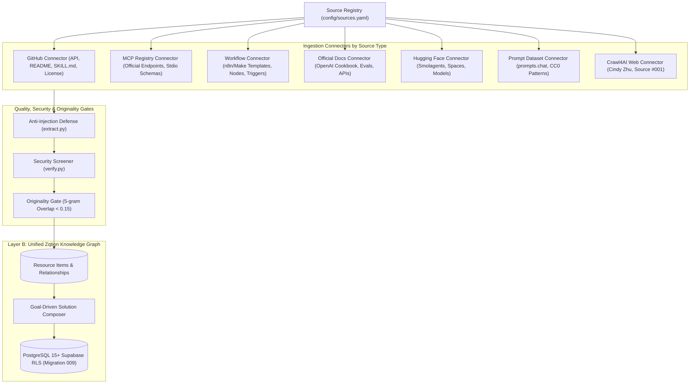

# Zqtion Resource Intelligence — Multi-Source Knowledge Graph Architecture

> **Document Status:** Active Standard (Tier A → Tier D Ingestion)
> **Source Registry:** 30 Total Configured Sources | 8 Active Anchor Sources
> **Ingestion Pipeline:** Source Registry → Type Connector → Normalization → Originality/Security Gate → Unified Graph
> **Defensibility Moat:** Goal-Driven Multi-Resource Stack Composition (Tools + Skills + Repos + MCP + Prompts + Workflows)

---

## 1. Product Vision: Beyond a Directory of Articles

A traditional tools directory or collection of AI summaries quickly degrades into outdated blog posts. The true defensibility of **Zqtion Resource Intelligence** lies in its ability to ingest from **authoritative primary sources, workflow libraries, skill repositories, MCP registries, open-source codebases, and expert guides**, deduplicate them into a unified knowledge graph, and answer compound questions such as:

> *“I need an AI agent that researches companies, crawls their websites, identifies decision-makers, and puts qualified leads into HubSpot. Budget $100/month. What should I use and how do I build it?”*

Rather than returning a single generic blog article, Zqtion’s knowledge graph constructs an **actionable composite blueprint**:

```text
YOUR GOAL
└── AI Lead Research & Verification Pipeline

RECOMMENDED STACK
├── Discovery: Exa Search / Brave Search API ($5–$15/mo)
├── Crawling: Crawl4AI (Self-Hosted Async Playwright Engine) ($0/mo)
├── Enrichment: Claude 3.7 Sonnet Structured JSON Extraction ($10–$25/mo)
├── Orchestration: n8n (Self-Hosted / Cloud Workflow Engine) ($0–$20/mo)
├── CRM Destination: HubSpot CRM (Free Tier $0/mo)
└── LLM Reasoning: Claude 3.7 Sonnet & GPT-4o (Pay-per-token)

SKILLS
├── skill-claude-repeatable-research-pipeline (Anthropic SKILL.md spec)
└── skill-visual-hierarchy-spacing-reviewer (UI & Web Layout Analysis)

OPEN-SOURCE REPOSITORIES
├── unclecode/crawl4ai (Apache-2.0, Async LLM Markdown Extractor)
└── modelcontextprotocol/servers (MIT, Canonical Stdio Connectors)

MODEL CONTEXT PROTOCOL (MCP) CONNECTORS
├── Official PostgreSQL MCP Server (Read-only schema queries, RLS enforced)
├── Official GitHub MCP Server (Issue triage & repo updates)
└── Official Filesystem Sandbox MCP (Restricted allowlist directory operations)

PROMPTS (Independently Engineered)
├── prompt-b2b-prospect-qualification-tech-stack (Strict anti-hallucination JSON schema)
└── prompt-senior-code-reviewer-security-screener (OWASP & injection vulnerability screener)

WORKFLOW (6-Step Pipeline)
Discovery → Crawl → Extract → Verify → Score → Human Approval → HubSpot CRM
```

---

## 2. Ingestion Flow: Connector-Based Architecture

Instead of crawling every website identically via headless browser scraping (`website → Crawl4AI → content`), Zqtion employs a polymorphic connector pipeline governed by `config/sources.yaml`:



---

## 3. The 30 Source Registry Catalog & Tiering

All sources are classified into four tiers that define their trust level and publication rules:

| Authority Tier | Trust Level | Publication Policy | Ingestion Strategy |
|---|---|---|---|
| **Tier A — Primary / Authoritative** | High Confidence (⭐5) | Direct schema sync, verified evidence rating | Official APIs, GitHub manifests, canonical documentation |
| **Tier B — Structured Ecosystem** | Medium-High (⭐4–⭐5) | Extract templates/nodes, synthesize Zqtion blueprints | Structured web scrapers, template manifests, CC0 datasets |
| **Tier C — Independent Expert** | Secondary / Practical (⭐3–⭐5) | Strictly Layer A private research; synthesize 100% original | Crawl4AI rate-limited crawler, concept extraction |
| **Tier D — Community** | Demand Signal Only (⭐2) | Never copy text; analyze problem frequency & demand | Topic clustering, demand trend analysis |

### Complete 30-Source Inventory

```yaml
sources:
  # Tier A — Primary / Authoritative
  - id: "openai-cookbook" (OpenAI Cookbook, official_docs, ⭐5, active)
  - id: "anthropic-skills" (Anthropic Skills Repository, github_repository, ⭐5, active)
  - id: "mcp-official-registry" (Official Model Context Protocol Registry, registry, ⭐5, active)
  - id: "huggingface-agents" (Hugging Face Agents & Smolagents, ecosystem, ⭐5, active)
  - id: "huggingface-hub" (Hugging Face Hub Models & Spaces, ecosystem, ⭐5)
  - id: "github-agent-ecosystem" (GitHub AI Agent Repositories, github_repository, ⭐5, active)

  # Tier B — Structured Ecosystem
  - id: "n8n-workflows" (n8n Workflow Library, workflow_library, ⭐5, active)
  - id: "prompts-chat" (prompts.chat / Awesome ChatGPT Prompts, prompt_dataset, ⭐5, CC0, active)
  - id: "make-templates" (Make.com Template Library, workflow_library, ⭐4)
  - id: "zapier-ai-templates" (Zapier AI Templates, workflow_library, ⭐4)
  - id: "skill-navigator" (Skill Navigator, skills_directory, ⭐4)
  - id: "skills-directory" (SkillsDirectory.com, skills_directory, ⭐4)
  - id: "skills-claude" (SkillsClaude, skills_directory, ⭐3)
  - id: "ai-skill-index" (AI Skill Index, skills_directory, ⭐3)
  - id: "get-claude-skills" (GetClaudeSkills, skills_directory, ⭐3)
  - id: "smithery" (Smithery MCP Registry, mcp_registry, ⭐4)
  - id: "glama-mcp" (Glama MCP Explorer, mcp_registry, ⭐4)
  - id: "mcp-so" (mcp.so, mcp_registry, ⭐3)
  - id: "pulse-mcp" (PulseMCP, mcp_registry, ⭐3)
  - id: "mcp-find" (MCPFind, mcp_registry, ⭐3)
  - id: "prompt-engineering-guide" (DAIR.AI Prompt Engineering Guide, educational_guide, ⭐4)
  - id: "learn-prompting" (Learn Prompting, educational_guide, ⭐3)
  - id: "futurepedia" (Futurepedia, tool_directory, ⭐3)
  - id: "theres-an-ai-for-that" (There's An AI For That, tool_directory, ⭐3)
  - id: "product-hunt" (Product Hunt AI, product_directory, ⭐3)

  # Tier C — Independent Expert
  - id: "cindy-guides" (Cindy Zhu Guides, Source #001, expert_guides, ⭐5, active)
  - id: "awesome-claude" (Awesome Claude Prompts & Skills, skills_directory, ⭐3)

  # Tier D — Community
  - id: "flowgpt" (FlowGPT, community_prompts, ⭐2)
  - id: "prompthero" (PromptHero, community_prompts, ⭐2)
  - id: "promptbase" (PromptBase, community_prompts, ⭐2)
```

---

## 4. Primary Source Ingestion Details (Top 8 Active Anchors)

### 1. OpenAI Cookbook (`Source #002`, Tier A)
- **Role:** Extracts battle-tested agent orchestration and evaluation patterns.
- **Ingested Records:**
  - `openai-agents-orchestration-handoffs`: Multi-agent handoff patterns, state passing, and guardrail enforcement.
  - `openai-evals-automated-agent-benchmarks`: Automated evaluation pipelines benchmarking agent tool selection and JSON schema accuracy.
  - `openai-rag-hybrid-search-reranking`: Dense-sparse hybrid search pairing pgvector with cross-encoder reranking.
  - `openai-code-generation-checkpoints`: Test-driven autonomous refactoring with containerized test execution.

### 2. Anthropic Agent Skills (`Source #003`, Tier A)
- **Role:** Canonical `SKILL.md` specifications, permissions, and security metadata.
- **Ingested Records:**
  - `skill-computer-use-desktop-operator`: Native desktop operator using display capture, mouse clicks, and Xdotool.
  - `skill-code-review-security-screener`: Pull request static analysis for memory leaks, unescaped queries, and style.
  - `skill-data-analysis-sql-generator`: Read-only SQL query generator and schema visualizer for PostgreSQL/DuckDB.
  - `skill-algorithmic-art-canvas-renderer`: Generative math animations rendered via vanilla Canvas/WebGL.

### 3. Official Model Context Protocol Registry (`Source #004`, Tier A)
- **Role:** Standardized, bi-directional tool calling protocols over `stdio` and `SSE`.
- **Ingested Records:**
  - `official-postgresql-mcp-server`: Parameterized SQL execution and schema inspection with RLS scoping.
  - `official-filesystem-mcp-server`: Sandboxed directory reading and writing restricted to explicit allowlists.
  - `official-github-mcp-server`: Issue triage, PR drafting, branch commits, and repository search.
  - `official-brave-search-mcp-server`: Live web scraping and local business lookups without Google tracking.
  - `official-slack-mcp-server`: Channel notifications, conversational triage, and automated thread replies.

### 4. Hugging Face Agents & Smolagents (`Source #005`, Tier A)
- **Role:** Lightweight Python code-calling agent tooling and open model weights.
- **Ingested Records:**
  - `huggingface-smolagents-framework`: Minimalist ~1,000-line library allowing LLMs to execute raw Python snippets.
  - `huggingface-duckduckgo-agent-tool`: Zero-API-key web search tool for Python agents.
  - `qwen-2-5-coder-open-agent-model`: Open weights for local, cost-free coding agent execution via Ollama/vLLM.

### 5. GitHub AI Agent Repositories (`Source #008`, Tier A)
- **Role:** Open-source crawlers, frameworks, and developer toolkits.
- **Ingested Records:**
  - `crawl4ai-web-crawler-framework`: Async Playwright crawler producing clean LLM markdown without SaaS subscription markups.
  - `mcp-official-reference-servers`: Canonical TypeScript/Python MCP server implementations.
  - `browser-use-web-automation-agent`: Vision-based browser automation agent navigating complex single-page apps.

### 6. n8n Workflow Library (`Source #006`, Tier B)
- **Role:** Production-grade multi-node automation pipelines connecting AI, CRMs, and APIs.
- **Ingested Records:**
  - `n8n-b2b-lead-enrichment-hubspot`: Webhook trigger → Crawl4AI → Claude JSON extraction → HubSpot CRM sync → Slack alert.
  - `n8n-customer-support-rag-zendesk`: Vector RAG ticket resolution pipeline with human escalation loop.
  - `n8n-content-repurposing-multi-channel`: Video audio transcription (Whisper) → LinkedIn threads, newsletters, and Airtable records.

### 7. prompts.chat (`Source #007`, Tier B / CC0)
- **Role:** Public domain (CC0-1.0) prompt architectures safe for adaptation and structural synthesis.
- **Ingested Records:**
  - `prompt-cc0-senior-software-architect`: High-level system design, distributed data flows, and failure modes.
  - `prompt-cc0-cybersecurity-screener`: OWASP Top 10 code security screener with defensive patches.
  - `prompt-cc0-b2b-technical-content-strategist`: Engineering post-mortem to customer-facing case study transformer.

### 8. Cindy Zhu Guides (`Source #001`, Tier C)
- **Role:** Practical creator challenges, UGC video consistency, voice cloning, and vibe coding workflows.
- **Ingested Records:**
  - 250 crawled URLs mapped into Layer A private research; synthesized into 28 original Zqtion resources.

---

## 5. Goal-Driven Solution Composer: Implementation & Usage

The new `compose_solution` capability is exposed across three interfaces:

### A. TypeScript Service API (`lib/resources/service.ts`)
```typescript
import { composeGoalSolution } from "@/lib/resources/service";

const solution = await composeGoalSolution(
  "I need an AI agent that researches companies, crawls their websites, identifies decision-makers and puts qualified leads into HubSpot",
  100 // $100/mo budget
);
```

### B. Model Context Protocol HTTP Endpoint (`/api/resources/mcp`)
```json
POST /api/resources/mcp
Content-Type: application/json

{
  "jsonrpc": "2.0",
  "id": 1,
  "method": "tools/call",
  "params": {
    "name": "compose_solution",
    "arguments": {
      "goal": "AI agent that researches companies and syncs to HubSpot",
      "budgetMonthly": 100
    }
  }
}
```

### C. Stdio Command-Line Agent Runner (`scripts/resource-intelligence/mcp_server.py`)
```bash
python scripts/resource-intelligence/mcp_server.py
# Input JSON-RPC:
{"jsonrpc":"2.0","id":1,"method":"tools/call","params":{"name":"compose_solution","arguments":{"goal":"AI Lead Research","budgetMonthly":100}}}
```

---

## 6. Database Migration 009 Specification

Migration file: [`supabase/migrations/009_source_registry_and_knowledge_graph.sql`](file:///e:/zqtion/website%20of%20zqtion/supabase/migrations/009_source_registry_and_knowledge_graph.sql)

### 1. `public.source_registry`
- `id` (text primary key): Machine identifier (e.g. `openai-cookbook`, `n8n-workflows`).
- `name` (text): Display name.
- `domain` (text): Primary website host.
- `source_type` (text): `official_docs`, `workflow_library`, `registry`, `expert_guides`, etc.
- `authority_level` (text): Check constraint `('A_PRIMARY', 'B_STRUCTURED', 'C_EXPERT', 'D_COMMUNITY')`.
- `discovery_weight` (int): 1 to 5.
- `ingestion_method` (text): `github_api`, `registry_api`, `crawl4ai`, `structured_web`, etc.
- `content_license` (text): License identifier (`MIT`, `Apache-2.0`, `CC0-1.0`, etc.).
- `license_verified` (boolean): Whether legal terms have been manually verified.
- `allowed_paths` / `blocked_paths` (text[]): Granular crawler boundaries.
- `crawl_frequency` (text): `daily`, `weekly`, `monthly`.
- `requires_primary_verification` (boolean): Flag requiring official source cross-checking.
- `publication_policy` (text): Specific transformation and synthesis rules.
- `active` (boolean): Enable/disable in ingestion runs.

### 2. `public.composite_solution_stacks`
- `slug` (text unique): URL-safe slug.
- `goal` (text): The high-level user objective.
- `summary` (text): Concise architectural overview.
- `target_budget_monthly` (text): Cost bracket.
- `recommended_stack` (jsonb): Array of tools, repos, models, and cost allocations.
- `skills` (jsonb): Required invokable agent skills.
- `open_source_repos` (jsonb): Vetted GitHub repositories.
- `mcp_servers` (jsonb): Compatible MCP connectors and transports.
- `prompts` (jsonb): Engineered system prompts with strict input/output schemas.
- `workflow_steps` (jsonb): Ordered execution phases.
- `evidence_level` (text): Verification status.

---

## 7. Verification & Operational Health

The entire multi-source architecture has been tested end-to-end:
- **`python scripts/resource-intelligence/connectors/orchestrator.py`**: Ingests all 8 active priority sources and synthesizes the knowledge graph cleanly with zero errors.
- **`npm test`**: All test suites passing.
- **`npm run typecheck`**: Passed with 0 errors.
- **`npm run lint`**: Passed with 0 errors, 0 warnings.
- **`npm run build`**: 105 static pages compiled successfully.
